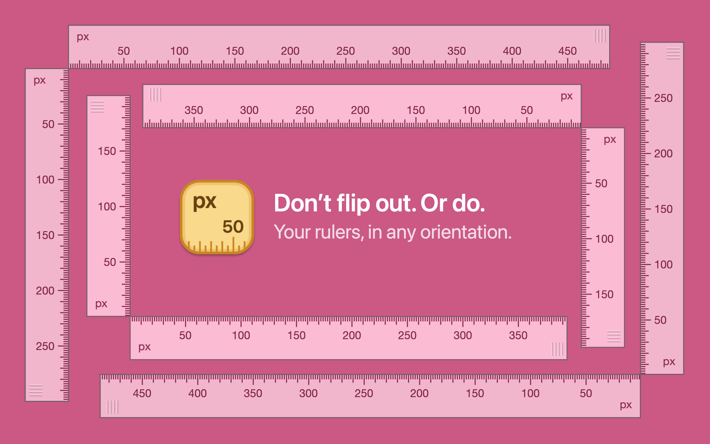
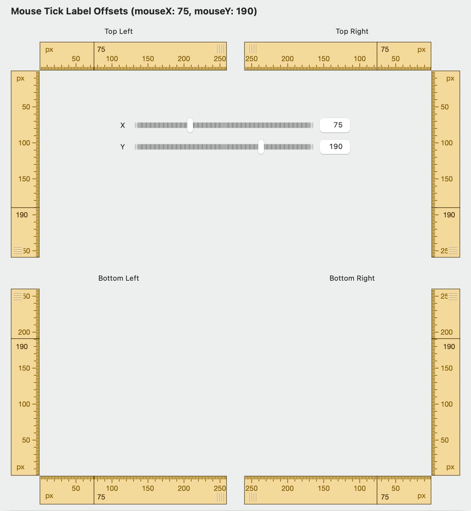

I've just shipped another oft-requested feature for [Free Ruler](/freeruler/): the ability to flip rulers horizontally or vertically.

{: .polaroid loading=lazy width=1200 }

This one was pretty involved, requiring a complete refactor of the ruler drawing code so that the ticks, labels, drag handle, and mouse ticks render correctly in any orientation. To help troubleshoot the layout code, I created a SwiftUI preview showing 4 sets of rulers, in each possible orientation, with sliders to set the simulate mouse position. This made it easier to adjust the layout logic and validate how the rulers rendered in each orientation.

{: .polaroid loading=lazy width=1200 }

And of course I added a bunch of UI and unit tests for good measure. (Snicker.)

You can download Free Ruler from [GitHub](https://github.com/pascalpp/FreeRuler/releases) or the [App Store](https://apps.apple.com/us/app/free-ruler/id1483172210?mt=12).
