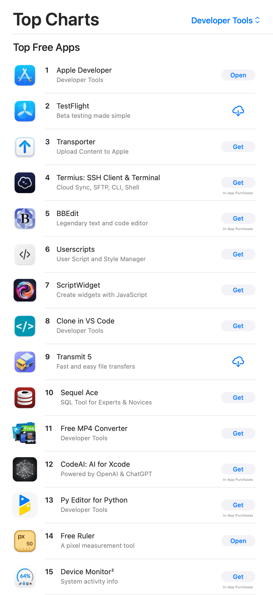

Free Ruler is now #14 in the Mac App Store!

{: .bordered }

…in the "Free Developer Tools" category. Some pretty good company in there!

---

You can download Free Ruler from [GitHub](https://github.com/pascalpp/FreeRuler/releases) or the [App Store](https://apps.apple.com/us/app/free-ruler/id1483172210?mt=12).

